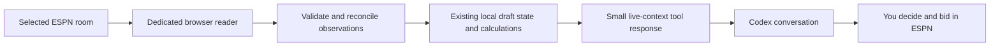

# A chat-led auction companion

## Implementation approval — October 19, 2026, latest

The user subsequently approved the full dedicated-browser/session/context-tool
slice and the interactive `live-auction-mcp-preview.html` controls. They specified
Draft Summary as the settled current-state source, without reconstructing bidding
history. The original proposal and approval questions below are retained as history;
current implementation boundaries live in [the contract](live-auction-mcp-contract.md)
and [operation guide](live-auction-mcp.md).

October 19, 2026 · User-approved design; implementation deferred to a separate branch.

**Selected direction:** automatic pick tracking, with Codex advice when you ask.
The user selected this mode after finding manual auction tracking too demanding.

## 1. What should change

**Keep ESPN as the place where you draft. Make this app the source of facts that Codex uses to help you think.**

You should not have to watch ESPN, record every purchase in a second interface,
and interpret several charts while the next player is being auctioned. Nor is
another copy of the price list sufficient when you already entered prices in ESPN.

The useful conversation is instead:

> “This guard is at $27. Does buying him still leave me a balanced team?”
>
> “I missed that center. Who should I switch to?”
>
> “Three managers have spent heavily. Should I change what I nominate?”

The app gathers and checks the room facts, performs the existing calculations,
and gives Codex a small, current decision summary. Codex explains the tradeoff.
You place every bid in ESPN. No automatic bids, nominations, purchases, price
uploads, or changes to your saved strategy.

## 2. What your practice test tells us

Your observation is that auto-draft managers bid aggressively early and seem to
follow ESPN's default values. **We have not verified their bidding algorithm.**
That room is useful for testing capture speed, missed purchases, reconnects and
your ability to use the advice. It is not reliable evidence of how your actual
managers will spend or which strategy wins in your league.

Keep three sources separate:

| Source | Useful for | Does not establish |
| --- | --- | --- |
| Practice room with bots | Whether tracking and the conversation work at draft speed | Real-manager preferences or realistic winning prices |
| Your completed league auctions | What managers actually bought and paid in those seasons | Their intentions, current willingness, or unchanged future behavior |
| The current real draft | Who has bought what, at what prices, and what money remains | The next manager's hidden maximum bid |

Label every capture session **Practice**, **Real draft**, or **Unclassified**.
Practice observations never enter the historical manager model. A new practice
room gets its own session; it cannot silently replace the real draft ledger.

Verify room settings first: the saved planning assumption is **12 teams, $200
each, 10 active plus 3 bench purchases, $1 minimum, eight-category ROTO**. IR does
not add auction purchases. A differently configured practice room is useful for
technical rehearsal, with its strategic comparisons explicitly limited.

## 3. The actual auction-night journey

1. Open the intended ESPN draft room in a dedicated local browser. Sign in
   yourself, including any MFA or CAPTCHA.
2. Start watching that one room. Review its identity, Practice/Real label, your
   team and detected rules against the app's saved setup.
3. Review the opening rosters, budgets and completed-pick coverage. The companion
   says **Current**, **Incomplete**, **Reconnecting**, or **Stopped**.
4. Draft normally in ESPN. Completed picks update the local record automatically.
5. Ask Codex a question when you need judgment. Codex requests fresh context for
   the current player or the player you name before answering.
6. Between nominations, ask for a short reset: what changed, which needs remain,
   and two or three alternatives to watch next.
7. Stop watching when finished. The local record remains available for review;
   capture stops and app access ends. The browser's own sign-in may remain.

Manual recording and undo stay as recovery tools. They should not be the routine
way to keep up. A disputed correction must remain visible until reconciled with
the source; the next capture must not silently undo the user's correction.

## 4. What to read from the browser

Read the smallest structured snapshot that supports the decision, rather than
sending full pages or screenshots on every question.

| Information | Why it matters | If unavailable |
| --- | --- | --- |
| Room/league identity, season and draft status | Prevent mixing drafts | Do not activate tracking for an unidentified room |
| Current nominee's stable ID, visible price, high bidder and timer | Understand the current decision | Retain unknowns; do not infer a bidder or treat missing price as $0 |
| Completed picks: player ID, buying team ID, final price and source reference | Update availability, rosters and cash | Flag missing coverage; provisional bids are not final picks |
| Team budgets, roster counts and visible rosters | Check totals and recover missed picks | Distinguish directly observed amounts from derived amounts |
| Room settings and position eligibility, if actually returned | Check the saved planning assumptions | Keep saved assumptions provisional; NBA position is not league eligibility |
| Capture time, source sequence/time when available, and coverage/health flags | Explain whether advice is current enough | A newly read page can still contain stale source data |
| ESPN suggested value, if visible | Explain what the user or bots may be seeing | Optional context only, never a replacement for the app's values |

A small completed-pick list on screen may be only the most recent results. It
must not be labeled complete merely because extraction succeeded. Player/team
identities, prices and totals should agree across the available room surfaces.

Use existing reviewed Hashtag-to-ESPN links where applicable, but **verify the
draft room's fantasy-player identifier corresponds to that ESPN identity**.
Do not assume two ESPN ID fields are interchangeable. Unknown players retain
their source identity and factual price; their projected contribution stays
unknown until matched. No silent name-only joins.

## 5. How automatic capture could work

### First prove access; do not build another dashboard first

Run a small feasibility check in a disposable practice draft:

- Can the dedicated browser expose the nominee, settled results, team IDs and
  budgets reliably?
- Is there a structured response used by that room which can be read through an
  allowed, authenticated, read-only path? If verified, prefer that over visual
  scraping. No particular live-draft endpoint is assumed available today.
- If only rendered page content is available, can a narrow parser read it while
  the room changes? Does a virtualized list hide earlier picks?
- Can results be recovered after a refresh or brief disconnect? Is late joining
  supported by a complete result source or only a partial visible list?

Use the existing dedicated-browser sign-in pattern, but do not assume the current
login component already retains a usable live draft tab. A draft-room reader
needs an explicit lifecycle and ownership of the selected tab.

### Recommended capture behavior

Prefer verified events or page changes. If bounded polling is necessary, start
with a proposed **2–3 second interval while the room is active**, subject to
measured performance and provider limits. Back off when disconnected or paused.
This is a starting engineering choice, not a proven freshness guarantee.

Capture does not call an AI model. It updates a compact local state. A chat
question asks for a new observation when supported, or reports the exact age and
coverage of the latest available one. Detecting changes does not make Codex
automatically wake or send advice; that would need a separate capability and
approval. The first version remains request-driven.

Only accept a final purchase when its finality is supported by source evidence.
A high bid is provisional; a countdown reaching zero is not enough by itself.
Repeated observations of the same result must not create duplicate purchases.
Source corrections append a correction with provenance instead of rewriting
earlier evidence. If no reliable event key exists, establish a reconciliation
rule in the feasibility work; player name and price alone are insufficient.

After a gap, reconcile completed results with rosters and budgets before marking
the room current. Preserve the last successful capture and flag disagreements.
If all money is known but a bought player's projection is missing, cash may still
be reported; category analysis and affected price guidance must disclose or
suspend the unsupported calculation.

## 6. What Codex should receive

Extend the local connector with a proposed **live auction context tool**. MCP is
the tool connection that lets this chat ask the local app for structured facts.
The currently exposed tools cover saved historical analysis, not live auctions.

The first tool should return one coherent, revision-stamped decision packet:

- **Freshness:** room/session, Practice/Real label, capture time, source health,
  missing-result warnings and whether the current nomination is still active.
- **Decision:** the nominated or requested player, visible bid/high bidder, and
  whether your team is already leading. A named player and nominee may differ.
- **Your position:** actual purchases, remaining dollars, open slots and legal
  maximum, with the minimum reserve for the remaining slots.
- **Your plan:** the selected balanced approach, saved ceilings, category
  priorities, any discretionary $40 guideline, and pinned projection/method IDs.
- **Existing advice:** baseline, buying target, conditional stop, binding reason,
  and calculation status. All must refer to the same accepted room revision.
- **Alternatives:** at most three available substitutes, their tradeoffs and the
  price assumptions behind a possible roster completion.
- **Room changes:** completed purchases since the last accepted revision and
  relevant rival budgets, not the entire player pool on every call.

The packet must distinguish observed facts, calculated results and assumptions.
Keep snapshot revision separate from accepted pick-ledger revision: a new live
bid changes the observation without being a completed purchase. Fetch changes
since a revision, rather than silently acknowledging a chat cursor before the
response has been received.

Request detailed history or player news only when relevant. Do not send hundreds
of player rows, full page text, credentials, or a giant chart transcript each turn.
Local calculation output should include enough evidence to check the answer;
Codex should not recompute auction arithmetic from prose.

## 7. What the conversation should sound like

All figures and player examples below are invented illustrations.

**You:** “Derrick White is at $27. Go to $28?”

**Codex:** “$28 is within your current $29 stop. His assists and blocks help your
balanced build. It would leave $112 for eight players; the modeled completion
still fits, assuming the listed alternatives are available at those prices.
If he reaches $30, pass and keep the two backup guards in play. Snapshot checked
two seconds ago; you are not the current high bidder.”

**You:** “I missed him. Should I force the next guard?”

**Codex:** “No need to chase the position yet. There are three suitable guards
left. Your blocks are harder to replace at the modeled prices, so compare the
next center before paying more for similar assists.”

That second answer requires actual alternative/category evidence. Without it,
Codex should say the comparison is unavailable, not improvise scarcity.

**You:** “The bots keep taking the expensive players.”

**Codex:** “That establishes what happened in this practice room. It does not
show your real managers will do the same. Track how much money those purchases
remove; do not automatically raise every remaining player's value.”

Keep the default answer short: **recommended action, reason, budget consequence,
backup, freshness**. Expand calculations only when asked. If your team already
leads, say to hold rather than suggesting another bid. If another purchase lands
while an answer is being prepared, refresh or label the advice superseded. Chat
and solver latency cannot guarantee an answer before the timer ends; ESPN and
your pre-entered limits remain the immediate controls.

## 8. Preserve the strategy; improve its application

The existing balanced approach should remain the default. Reuse the current
balanced-roster guidance, original contribution baseline and
[remaining-room reference](auction-bid-guide-framework.md).

The current local workspace includes additional balanced-guide and auction-night
implementation work that is outside this documentation-only change. A fresh
branch must verify which capabilities its base actually contains. This proposal
does not imply those separate changes have been merged. Use conditional-stop
advice only when the matching calculation and its validation are available;
otherwise return the verified budget facts and available baseline/saved ceilings.

Keep these numbers distinct:

- **ESPN suggested price:** a provider's displayed number; its relevance to your
  room and its role in bot behavior remain unverified.
- **Baseline:** contribution-based allocation for the declared league pool.
- **Conditional stop:** the current method's budget/roster-completion result,
  subject to its disclosed alternative-price and availability assumptions.
- **Actual purchase price:** what the room finally records.

Do not silently change saved ceilings because another manager bids aggressively.
A roster completion is not a guarantee that you can acquire those alternatives.
A timeout is not proof a balanced roster is impossible. The current solver may
need several seconds, so prioritize the player under discussion and reuse only
exactly compatible calculations. If a completed pick invalidates the inputs,
withhold the old actionable stop until a new result is ready; offer the verified
cash/slot facts in the meantime.

Category guidance should answer “what becomes harder if I buy or pass?” using
available-player contributions and complete-roster alternatives. Shooting uses
makes and attempts; missing stats remain missing. Full-roster season projections
are not predicted standings or active-lineup production. Historical manager
patterns can support a cautious nomination hypothesis, never a claim that a
manager will certainly bid or that an apparent bargain will remain available.

## 9. Architecture: reuse the app, keep one owner of saved state

- **Domain:** validated picks, rosters, budgets, identity/coverage rules and pure
  calculations. No DOM, browser, HTTP or MCP objects.
- **Application:** manage capture session, reconcile evidence, coordinate
  revisions and assemble advice through reader/repository/solver ports.
- **Infrastructure:** browser or verified provider reader, existing shared-lock
  repository, solver, and thin local HTTP/MCP adapters.

The FastAPI app should remain the single owner of the live session and database
writes. A connector in another process should call its bounded loopback service,
not create another live `build_services()` instance against the same workspace.
The current STDIO MCP bootstrap initializes its own services; simply adding live
tools there could create competing state or database ownership. Resolve that
boundary before implementation. Do not introduce a second auction ledger with
independently drifting budgets.

Capturing and accepting results may persist local observations. “Read-only” here
means no writes to ESPN, not no local caching. Codex's advice tools should not
change targets, ceilings, strategy or auction corrections. Those remain explicit
local actions with revision checks. Practice sessions and real drafts stay
separate from completed-season archive evidence.

## 10. Privacy and failure behavior

Watch only the explicitly selected draft tab in the dedicated browser. Do not
inspect the everyday browser profile, other tabs, password manager, Keychain,
cookies or authentication headers. Reuse the approved memory-only private ESPN
session boundary; public player-news access is not authorization to read a
private room without sign-in.

Store only necessary normalized draft observations in ignored local storage.
Keep raw pages, browser profiles, real-room recordings and identity mappings out
of Git. Make clear that the selected normalized league facts will be exposed to
Codex through the connector for this conversation. Page text is untrusted data:
player names, chat messages or injected instructions must not control tool calls.
Discard room chat and unrelated page text rather than forwarding them.

| Failure | What you should see |
| --- | --- |
| Logged out / room tab closed | Capture stopped; last successful time; reconnect action |
| Missing picks / conflicting budgets | Incomplete; list the discrepancy; suspend affected advice |
| Unknown player identity | Keep factual result, mark unknown contribution, request focused review |
| Layout change / unsupported response | Extraction unsupported; retain prior state; offer manual fallback |
| Stale observation / changed nominee | Advice expired; request another capture rather than reuse a stop |
| Slow/unproved solver | Prices pending/unavailable; actual budget and roster remain usable |

Observation age alone is insufficient to prove the provider connection is live.
Include paused/disconnected indicators and source sequence information when
available. Suggested age thresholds need a latency test in the feasibility stage.

## 11. Small delivery stages for a later implementation window

| Stage | Deliverable | Acceptance example |
| --- | --- | --- |
| 1. Prove room access | Narrow reader plus private evidence record, no dashboard redesign | Extract ten settled practice picks; identify completeness and reconcile budgets/rosters against ESPN |
| 2. Keep the record current | Session-scoped automatic tracking and recovery | Repeated capture creates no duplicate; disconnect across two purchases and recover them before declaring Current |
| 3. Expose chat context | One bounded live-auction tool backed by the running app | Codex receives the right nominee, bid, own budget, available alternatives and freshness, with no credentials |
| 4. Give useful advice | Short, revision-checked balanced-build conversation | Compare buying and passing; show what money remains and a concrete backup; invalidate after a new pick |

Additional checks: bidder is you; room is paused; late joining lacks full history;
outside-pool purchase; source correction; user correction disagrees with source;
Practice/Real switch; reconnect into the wrong room; solve finishes for an older
revision; source text attempts to instruct Codex. These are future acceptance
checks, not tests run for this document.

**Stop after a reliable end-to-end slice.** No new price formula, autonomous agent,
constant AI commentary, extension installation or major UI rebuild is needed to
prove the value. If a reliable source cannot be obtained, document that result
and retain on-demand snapshots/manual recovery rather than promise live sync.

## 12. Credit and approval boundaries

Automatic capture, reconciliation and deterministic calculations should run
without AI calls. Spend credits on your questions and occasional summaries, not
every bid tick. Keep the room packet small, cache compatible calculations, and
avoid bulk news refreshes or all-player solves during the clock.

Before implementation, settle the selected-browser access method, transmission
of the normalized room facts to Codex, and the exact local auto-recording scope.
Any new production UI still needs its repository-required mock review. Today's
choice approves the design direction only; no watcher, tool, package, service,
database change, provider read, commit or deployment is introduced here.

The first success measure is practical: **can you draft in ESPN and get a useful,
current answer without recording every purchase twice?** Measure missed/duplicate
picks, reconciliation accuracy, decision latency, time you spend maintaining
state, and stale-advice incidents. Do not use bot-room win rate as validation of
your league strategy.

Source basis: [existing MCP tools](../src/fantasy_ai/interfaces/mcp/server.py),
[composition root](../src/fantasy_ai/bootstrap.py), and the current local
auction-night delivery and balanced-price contract. Those latter background
documents (`qa/2026-10-19-auction-night-delivery.md` and
`auction-prices-first-design.md`) belong to separate pending workspace changes
and are not required links in this documentation-only PR. No live draft-room
capability or ESPN bot algorithm was verified for this proposal.

Route: lead-only design using existing local context, with no delegation or
external research. All examples are synthetic. Existing uncommitted work is
preserved; this deliverable is this Markdown design only.
