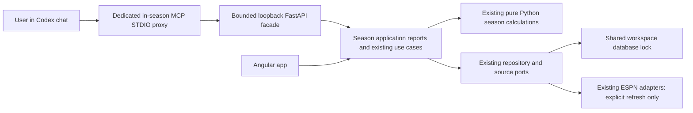

# In-season analytics through MCP

**Design date:** October 25, 2026
**Status:** Design only; no MCP tools, routes, calculations or UI changes implemented.
**Decision:** The user wants the live-season analysis journey available to Codex
through chat. They confirmed inclusion of explicitly invoked refresh and local
watch-note tools. Implementation belongs in a separate chat. The user subsequently
authorized security-reviewed commit/PR merge; this does not authorize implementing
the proposed tools.

## 1. Outcome and scope

Personal question: “Given my current league position, which waiver players should
I investigate, which roster players should I review, and what would change if I
replaced one of them?” The same answer should be available through the app and
through Codex, from the same evidence and Python calculations.

The chat journey is:

1. Understand current league position, category gaps, vulnerable leads and trends.
2. Choose an approach and extra category focus, retaining all category tradeoffs.
3. Rank available players from strongest fit down and the roster from lowest fit up.
4. Investigate players using actual production, projection comparison and dated news.
5. Compare selected alternatives independently against the same replacement.
6. Save a watch reason with its evidence and assumptions; revisit against new data.

Daily collection and explicit refresh support this journey. They do not make
saved evidence current automatically. “Live season” means the active season's
observations, not a continuous feed or an assertion of up-to-the-minute health.

**Acceptance example — synthetic:** In a fictional league, AST is a reachable
gap and FT% is vulnerable. Codex requests an AST-focused ranking, shows the top
five returned waiver candidates and the lowest-fit roster players, then explains
why one candidate helps AST but hurts FT%. Two selected candidates can each be
compared with the same replacement. A seven-day comparison waits for both start
assumptions. A saved note retains the exact source, window, priorities and units.
Changing evidence invalidates the old comparison instead of quietly rescoring it.

This design exposes existing descriptive analytics and heuristics. It does not
introduce an expected-roto-point optimizer, future participation model,
injury-adjusted projections, lineup optimizer, multi-add package search, FAAB
bidding recommendation or ESPN transaction capability.

## 2. Starting point: what exists and what does not

The proposed names in this document are **not currently callable tools**.

| Existing capability | Current implementation | MCP status today |
| --- | --- | --- |
| Historical league context, season results and cohort research | `interfaces/mcp/server.py` | Existing historical tools; preserve them |
| Live auction context | `interfaces/mcp/live_server.py` → running loopback app | Existing `get_live_draft_context`; preserve draft-only semantics |
| Current league landscape, standings, daily trend, source/rule status | `SeasonService.view` | Available through HTTP/app, not in-season MCP |
| Holistic waiver/roster fit and category focus | `SeasonService.player_fits` | Available through HTTP/app |
| Category-ranked players and recent-game trends | `SeasonService.research` | Available through HTTP/app |
| Same-replacement alternatives and native differences | `SeasonService.recommendations` | Available through HTTP/app |
| Player metadata, ESPN news and season outlook text | `SeasonPlayerNews.view/refresh` | Available through HTTP/app |
| League refresh/cancel and watch notes | `SeasonService.refresh/cancel/watch` | Available through HTTP/app |

Reuse the [approved workflow](season-workflow-design.md),
[actuals-first contract](outlook-live-fit-design.md),
[live-season implementation contract](live-season-implementation-contract.md),
[delivery evidence](qa/2026-10-25-season-workflow-delivery.md), and the project's
[MCP interface learning](learnings/mcp-agent-interface.md).

The facade should present recognizable analytical tasks, not mechanically turn
every REST route or database table into a tool. A useful daily review should need
one initial call, followed by focused drill-downs. Avoid an opaque “answer any
fantasy question” tool that embeds another agent on the server.

## 3. Architecture and process ownership



The UI arrow denotes shared application behavior; Angular still reaches it
through the existing HTTP interface.

- Add a dedicated **Fantasy Basketball In Season** MCP server. Do not overload
  historical `get_season_results` or the auction-specific live context tool.
  Do not change either existing server's contract or startup behavior.
- Follow the live-auction proxy pattern: the running app owns browser/session
  state, collection tasks and the one workspace database connection/lock. The
  new STDIO process must not call `build_services`, open DuckDB, read credentials
  or create a second writer. The app must be running; the browser pane need not
  be open for saved analysis.
- The proxy validates the existing app health identity, calls fixed loopback
  routes only, validates typed responses, follows no redirects and ignores
  environment proxy configuration. No caller-supplied host, URL, path or SQL.
- Proposed agent-facing HTTP namespace: `/api/season/agent/*`. These routes are
  new design work, not existing endpoints. Keep the existing routes compatible.
- Composition that needs a consistent snapshot belongs in a small application
  report use case. The HTTP/MCP adapters select and bound output; they do not
  calculate priorities, ratios, ranks, net changes or new injury effects.
- Extend existing ports only where needed for a consistent read. Do not introduce
  a generic agent framework, second repository system or persistent chat session.
- Ordinary analytics read saved state only, including saved news. The UI's
  refresh-on-inspection news policy must not become a hidden write in an MCP
  research read. Refresh has separate, clearly named tools.

## 4. Shared scope, evidence and result contracts

These are proposed typed contracts, not Python implementation code. Use closed
Pydantic request schemas at the interface boundary and the repository's existing
application/domain conventions internally. Reject unknown arguments.

### ContextRef

Returned by the initial outlook call; required by subsequent scoped calls:

| Field | Meaning |
| --- | --- |
| `league_id` | Current configured league ID; not an arbitrary remote league |
| `season` | Explicit active ESPN season label; currently 2027 for 2026–27 |
| `team_id` | Reviewed/configured My team ID, scoped to league and season |
| `signature` | Existing season evidence signature returned by the app |

The server resolves the selected league, configured live season and My team on
bootstrap. Never infer a season from the wall clock or substitute the historical
archive filter. Never choose the first team when My team is unset. Return team
choices and a setup recovery action; do not silently save a preference.

The current HTTP router defaults to 2027. A future facade should share one
explicit active-season source with the app rather than introduce an independent
MCP default. An explicit requested season must be supported by that live-season
configuration or fail clearly; historical analysis uses the historical tools.

### Scenario

| Field | Type/default | Rule |
| --- | --- | --- |
| `basis` | `recent` or `projection`; default `recent` | One selected rate source for both populations and both comparison sides |
| `days` | `7`, `15`, `30`; default `7` | Calendar-day actuals sample, not last N games or assumed future starts |
| `strategy` | `balanced`, `chase`, `protect`; default `balanced` | Preserve existing priority heuristics |
| `focus_categories` | Unique category codes; default `[]` | Validate against this league; canonicalize in league category order |

Selected categories receive **2× raw priority before normalization across all
categories**. All categories and losses remain. Empty focus means automatic
whole-team balance. Selecting every category doubles them equally and therefore
does not change normalized shares. Do not describe focus as an exclusive-category
filter or an optimal strategy.

Return an `AnalysisRef` containing `context`, canonical `scenario` and an
`analysis_key`. The key identifies the context signature, actual/projection
source references and cutoffs, source-window policy, priority/fit method versions
and canonical scenario. It is a stateless currency check, not a stored plan or
secret authorization token. Validate/rederive it in the app.

Rank reads accept a context plus a scenario to support intentional focus changes.
Drill-downs/comparisons receive the returned `AnalysisRef`; they must not silently
revert to defaults. Changing the scenario produces a new key. A new app instance
must either validate the reference against the same saved evidence/method or
return an explicit context-change result.

### Common result envelope

| Field | Required behavior |
| --- | --- |
| `schema_version`, `request_id`, `generated_at` | Distinguish response format, request correlation and response time |
| `state` | `ready`, `partial`, `unavailable`, or `context_changed`; per-section states also allowed |
| `context`, `analysis_ref` | Echo resolved scope and scenario when analytical results exist |
| `evidence` | Observation ID/time, ownership/pool time, actual cutoff and inclusive bounds, projection source/version/time, method versions |
| `coverage` | League/category completeness and reconciliation; returned/fit-complete/unranked counts by population; pool completeness flag |
| `data` | Bounded, task-specific facts and calculated values |
| `limitations` | Stable codes plus short explanations; relevant to the returned data |
| `next_actions` | Suggested tool and safe arguments, or a local app setup/reconnect route |

`generated_at` never replaces a source timestamp. News publication time,
last successful news check and latest attempted check/error remain separate.
A retained older recent-game history after a failed refresh keeps its older
cutoff. The comparison's units must appear beside its score and native values.
No raw provider JSON, cookies, internal identity tokens or browser state.

### Snapshot consistency and stale references

The existing signature includes calculation version, saved observation identity,
selection/preferences and saved projection version. It is not a token for every
independent state: watch revision and public news freshness are separate.

A composed report must pin one compatible observation/projection/selection,
then validate every component's signature/source identity and recheck currency
before returning an actionable ranking or comparison. Current `research` reads
latest state independently; simply issuing several service/HTTP calls without a
composition guard can mix observations. Prefer an application-level pinned read;
a bounded retry of a read is acceptable, but repeated changes return
`context_changed`. Never combine old priorities with new player rates.

Watch records retain their saved scope; news can have independent per-player
versions. Return those separately instead of invalidating a fit merely because a
headline was refreshed. If ownership or a required fit input changes during a
request, withhold the affected analytical result. Saved known facts may still be
returned as explicitly dated partial evidence.

## 5. Tool catalog

Names below are the proposed stable, unprefixed MCP tool names. Codex may display
a server namespace around them. Seven are read-only tools; four explicitly
request collection or local persistence. Metadata is informative, not an
application authorization mechanism.

| Tool | Main question | Effect |
| --- | --- | --- |
| `get_in_season_outlook` | Where am I, what needs attention, and who merits a first look? | Saved read |
| `analyze_in_season_categories` | How do we compare by category, and where are gaps/leads? | Saved read |
| `rank_in_season_players` | Which available players fit this focus, and who contributes least on my roster? | Saved read |
| `research_in_season_players` | Why this player, what has changed, and what does dated news say? | Saved read |
| `compare_in_season_moves` | What changes for each target against the same replacement? | Saved read |
| `get_in_season_watchlist` | What did I save, and which assumptions need rechecking? | Saved read |
| `get_in_season_refresh_status` | Is my requested collection running, complete or failed? | Status read |
| `refresh_in_season_data` | Collect new league evidence now | Explicit provider reads and local observation write |
| `cancel_in_season_refresh` | Stop the named running league collection | Explicit cancellation |
| `refresh_in_season_player_news` | Check public ESPN news for these named players now | Explicit public reads and local evidence write |
| `save_in_season_watch` | Remember this player/move and my reason | Explicit local append-only write |

Saved reads use `readOnlyHint=true`. Mutating tools use `readOnlyHint=false` and
accurate non-destructive/provider-access metadata supported by the installed
FastMCP version. Do not advertise a refresh or append-only note as idempotent
unless real deduplication is implemented. Register only the curated capabilities;
no generated “all HTTP endpoints” exposure.

### 5.1 `get_in_season_outlook`

**Suggested description:** Read the saved active-season league/team context,
current category needs and a small waiver/roster shortlist. Start here when scope
is unknown. Descriptive fit only; never refreshes ESPN or saves decisions.

**Inputs:** optional `league_id`/`season` as assertions against configured live
scope; optional `scenario` with the defaults above. No team inference from names.

**Default output:**

- Resolved league/season/My team and IDs, connection/collection state and dates.
- Current own overall rank/points if complete; all own category values, ranks,
  weighted points, native gap up, buffer below, ties and reconciliation flags.
- Current priority shares with gaps/scales and the canonical `AnalysisRef`.
- Top **5** rankable returned waiver targets and lowest-fit **3** rankable roster
  players, with brief signed contribution summaries, score units and GP/minutes.
- A compact daily trend summary and missing-collection count. Exact daily rows
  are a category/landscape drill-down, not an interpolated chart reconstruction.
- Returned/rankable/unranked denominators and injury/status caveats. A player
  status is the dated saved provider status, not a medical or participation model.
- Pickup constraints: FA/waiver rules, clearance if known, FAAB economy, remaining
  budget/minimum bid, limits and lineup lock; unsupported rules remain unknown.
- Watch revision/count and next drill-down actions. Do not include every watch,
  headline, game log or raw player vector in this initial response.

Rank calculations still consider the full eligible returned populations before
truncation. If no team is selected, return the league facts and team choices,
withhold personal fit and explain setup. If fit is unavailable, return known
standings/coverage instead of turning the whole response into an empty error.

### 5.2 `analyze_in_season_categories`

**Inputs:** `analysis_ref`; optional `category_codes` (unique current codes,
default all); `include_league_matrix=false`; `history_days=14` (1–90).

**Output:**

- Selected category definitions, direction, league scoring weights, exact own
  rank/points/value, gap/buffer, tied opponents, priority share and geometry.
- All-team values/ranks/points for requested categories; full team×category
  landscape when `include_league_matrix=true`, including overall standings.
- Latest saved observation per New York date, actual total roto points, null
  dates/unknown values, missed collection dates and observation references.
- A bounded explanation of what the current gap means, and a research action:
  e.g. examine assist volume, or efficient FT makes with sufficient attempts.
  Exact gap is a fixed-opponent reference, not a future guarantee.
- Supported next scenarios (balanced/chase/protect and valid focus codes), without
  silently selecting an optimum or persisting a new preference.

Use this for the heatmap/bar-chart information in chat. Display exact ties,
weighted totals, category units and reconciliation issues. Do not infer a
category's historical trend from total-point history if category history is not
actually available in the pinned report. Any additional category-history series
requires a same-formula read of saved observations, clearly identified as an
application report extension.

### 5.3 `rank_in_season_players`

**Inputs:** `context`; explicit `scenario`; `ranking="overall_fit"|"category"`
(default overall); `category_code` required only for category ranking;
`population="both"|"available"|"roster"` (default both); optional `query`,
`positions`, `exclude_status_codes`; `include_unranked=false`; `limit=10` per
population (1–25); opaque `cursor` optional.

For overall fit, call the existing player-fit use case. Category mode reuses
`research`; extending its ordering to own roster, if needed, must use the same
application/domain category score and explicit inverse order, not a new formula
in MCP. Mark that bounded extension in the implementation plan.

**Output row:** stable player ID/name/positions, observed ownership and FA/waiver
state/clearance, dated status, full-population rank, score and units, GP/minutes,
source completeness/reasons, top helpful and harmful coordinates. Full vectors
are available from research. Return a common full-population absolute-score scale
if a chat visualization is useful; this scale does not make the index a probability.

Rules:

- Available: only returned players with no fantasy team and `free_agent`/`waiver`
  status. Roster: current My team roster, retaining missing metadata as unknown.
- Available strongest first; roster lowest first. “Lowest fit” means lowest
  contribution to this selected research index, not historical fantasy value or
  an instruction to drop the player.
- Compute ranks before search, position/status filtering, pagination or truncation.
  Preserve the existing player-fit competition ties (1, 1, 3), deterministic
  name/ID ordering and explicit unranked rows. Category/team ties retain their
  existing use-case rules; do not substitute a universal tie convention.
- Default pages contain rankable rows. Always return unranked counts and the
  means to inspect them. `include_unranked=true` pages place them after rankable
  rows with null score/rank, never score zero.
- Excluding a status requires an explicit filter; do not silently remove injured
  players or change their production. Return the applied filter and counts.
- Cursors bind context, scenario, filters, population and ordering. Reject a stale
  or mismatched cursor; never splice pages from different observations.
- Rank-only fields are not expected roto gains. FT%/FG% category order follows
  the existing volume-aware makes-above-team-rate score, not player percentage.

### 5.4 `research_in_season_players`

**Inputs:** `analysis_ref`; exactly one of `player_ids` (1–5 distinct IDs) or
`lookup`; `game_limit=10` (0–30); `news_limit=2` per player (0–3).

`lookup` has optional `query`, `population` (`all_observed`, `available`,
`roster`) and `status_codes`, plus bounded cursor/limit (1–10). Require a query
or status filter. Return source status codes available for filtering in context
metadata. If lookup has multiple matches, return IDs/display facts and ask Codex
to resolve the intended player; do not deep-research an arbitrary first match.
If exactly one match exists, research it directly. A name can locate candidates;
it never establishes a cross-provider identity or a projection join.

**Research output for each resolved player:**

- Current fantasy ownership, source status, eligible positions/clearance and
  missing metadata. Stable ID is authoritative; display names remain untrusted.
- Selected source's full native per-game vector and all category normalized/
  weighted fit coordinates under the supplied priorities. Gross contribution is
  labeled separately from a replacement-dependent net comparison.
- Selected 7/15/30-day actual sample, GP, observed MPG, inclusive bounds, preceding
  non-overlapping window's sample and category trend, and bounded dated game
  values. Expose the same recent PTS/REB/AST support as the UI; do not imply that
  all source fields have complete history.
- Saved projection vector/minutes and its source date/version as a **separate**
  baseline. When ranking on projections, recent games remain supporting facts.
- Saved ESPN metadata, latest fantasy update/additional reports, attribution,
  publication/check times, safe source links and retained-source error state.
  Deduplicate the same item across update/articles. Season-outlook text has an
  unknown date/season when the provider did not supply one; do not call it news.
- Clear supports/tradeoffs from the existing signed vector, small-sample warning,
  missingness and next action to compare or explicitly refresh public news.

News text does not change rankings. For a broader injury review, lookup the
saved flagged statuses, page over the observed population, and research bounded
batches. “All observed flagged players checked” is not “all NBA injuries checked.”
The current source is not a complete league-wide injury feed, and a status filter
can miss outdated/unflagged reports. Return coverage and cutoff limitations.

Codex can connect a sourced injury report with possible role implications, but
must label that reasoning as qualitative and uncertain. No automatic minutes
boost, medical return-date inference or causal claim enters the numerical vector.
If the user requests latest reports, use the separate news-refresh tool for a
bounded named set, then read/research again with the new news timestamps.

### 5.5 `compare_in_season_moves`

**Inputs:** `analysis_ref`; `candidate_ids` (1–5 distinct available IDs);
`drop_id` (one own-roster player); `horizon="per_game"|"seven_day"` (default
per game); `added_starts`, `removed_starts` only for seven-day mode.

- Per game resolves to exactly one played game each. Reject supplied weekly
  start fields in this mode, even if they happen to equal one. The facade maps
  internally to the existing 1/1 domain comparison contract.
- Seven day requires both starts, strict integers 0–7. Zero is valid; missing is
  not zero. These are hypothetical credited starts, not verified games or slots.
- Each candidate is an independent alternative against the same `drop_id`.
  Never sum candidates as a package or silently pair them with different drops.

**Output:** keep score 0; each alternative's net fit and existing full-pool move
rank; every category's incoming native contribution, outgoing native contribution, signed native difference, normalized coordinate, priority and
weighted effect; shooting makes and attempts; missingness/reasons; source and
units. Move rank is distinct from gross waiver-fit rank. Preserve the existing
full-pool move rank after selecting alternatives; do not renumber a filtered set. Preserve negative and non-improving alternatives.

Reuse `recommendations`, filter its full computed result to the requested IDs,
then return all requested candidates. Do not merely return its top N, which can
omit the user's chosen lower-scoring target. Ineligible or newly owned IDs cause
an explicit scope/candidate error; missing stats yield an unranked alternative
with known native values retained.

Seven-day mode includes the existing ±1 incoming-start sensitivity, bounded at
0/7, with outgoing starts held fixed. Per-game mode has no such opportunity
sensitivity. `forecast_points` remains null/unavailable. No endpoint team
percentage can be calculated without the other future team shooting components.

### 5.6 `get_in_season_watchlist`

**Inputs:** `context`; optional player/query filter; `limit=10` (1–25); cursor.

Return note IDs/reasons, saved player/drop, kind, actual/projection basis and
window bounds, strategy/focus, priority snapshot, method/source references,
comparison horizon/starts, saved time and current watch revision. Include current
ownership and explicit “needs recheck” flags when the saved observation/signature
or player presence differs. Avoid attaching every news report by default.

A saved note is historical context, not a current score. Legacy notes with absent
focus mean no extra focus; legacy fit moves with absent horizon retain manual
seven-day semantics. Player-only notes do not imply 0 planned starts. Preserve
legacy category notes and their labels. Return a structured `revisit_request`
that restores saved source/scenario/units but requests fresh analysis under the
current context; never overwrite the saved evidence with the re-evaluation.

## 6. Explicit refresh and local-note tools

These tools are part of the requested design, not permission to execute them in
this chat. Future use follows direct user intent. Do not repeatedly ask approval
when the user has clearly asked to refresh or save a note; do not refresh/write
as an implicit side effect of “explain this score.”

### 6.1 `refresh_in_season_data`

**Inputs:** `context`; correlation `request_id`. Return promptly with an
application-issued `operation_id`, scope, start time, running/terminal state and
status tool arguments. The reference is an intent to refresh this league/team
context, not authority to refresh a different configured selection.

Delegate to the existing explicit league refresh. It requires the dedicated
Connect ESPN flow and memory-only session. A missing/expired session returns
`CONNECT_REQUIRED`; the user completes sign-in/MFA/CAPTCHA directly. Do not open
or automate credentials through MCP. Concurrent refresh returns the active
operation reference, without starting another collection. Preserve the existing
successful observation on failed collection.

No automatic polling/model commentary loop or new scheduling preference. An
explicit refresh can collect in the background in the app while chat continues.
A timed-out acknowledgement is **completion unknown**, not proof it never began;
check status before any retry. Echoed `request_id` alone is not deduplication.

### 6.2 `get_in_season_refresh_status`

**Inputs:** `operation_id` and league/season scope; no old fit signature required
because success changes evidence. Return only collection phase/state, safe
message, last successful observation/source times, per-section failures and
whether to read a new outlook. It must not run rankings, trigger collection or
poll on behalf of the caller. Prefer a bounded status check; the agent must not
claim it can keep watching after its turn ends.

The current service has process-local `Operation` state but no durable public
operation ID. Add a small application-issued operation identity and process
instance identity for these controls. On restart, return `OPERATION_UNKNOWN`
with current saved evidence/state; never pretend an old ID belongs to a new job.
This is a required application extension, not an existing API capability.

### 6.3 `cancel_in_season_refresh`

**Inputs:** `operation_id` and league/season scope. Cancel only the matching
running collection through the existing cancellation path. Completed is a safe
no-op; an unknown/mismatched ID must not cancel a different active operation.
Distinguish cancellation requested from cancellation completed. Successful older
observations remain available. No generic process-kill tool.

### 6.4 `refresh_in_season_player_news`

**Inputs:** `context`; `player_ids` (1–5 distinct observed ESPN-native IDs).

Call the existing fixed-host public ESPN reader through `SeasonPlayerNews`.
No private league cookies, no Connect ESPN requirement for these public reads,
no arbitrary link fetching and no external provider added. Preserve its maximum
two concurrent reads and per-player single-flight protection. Return per-player
success/failure, successful check time, retained prior report time and safe error.
One player's failure must not discard other players' successful results. Apply
existing identity/name validation; unmatched identity remains unavailable.

The tool refreshes dated metadata/news; it does **not** refresh private ownership,
recent game logs, projections or injury-adjusted rates. Re-run the relevant
saved research read to explain the refreshed reports in team context.

### 6.5 `save_in_season_watch`

**Inputs:** current `analysis_ref`, `expected_watch_revision`, `player_id`,
`reason` (0–2000 characters), and a discriminated `context_kind`:

| `context_kind` | Required fields | Forbidden/implied fields |
| --- | --- | --- |
| `player_fit` | Player in current roster or returned available pool | No drop/horizon/start assumptions; internally store the existing player-only 0/0 representation |
| `move_fit` | Available target, one own-roster drop, horizon and exact comparison assumptions | Per-game maps to 1/1; seven day requires explicit 0–7 starts |

Delegate to `SeasonService.watch` and recompute/validate the applicable current
context. Do not accept a model-provided score, priority snapshot or source date
as authoritative. Map `player_fit`/`move_fit` to the existing `fit_context=player`/`move`;
scenario strategy to `fit_strategy`, days to `window_days`, focus to
`focus_categories`, horizon to `fit_horizon`, and expected watch revision to the
existing revision argument. Persist app-computed signature, versions, selected
source and bounds, canonical focus/strategy, native comparison units and existing
revision metadata. Return the saved note ID, new watch revision and saved context.

The tool appends a note; it does not execute a waiver claim, drop a player,
change FAAB, change My team, save a global ranking preference or create a monitor.
Standalone category-priority persistence is not an existing feature. Put a
category focus in a player watch reason/scenario; retain old category-note reads.

On revision conflict, preserve the user's draft and return the current revision
and a read/review action. Never auto-rebase or overwrite a newer note. On a lost
acknowledgement, report completion unknown and read the watchlist before further
writes. Do not blindly resubmit an append. Strict retry deduplication would need
an additional persisted request contract; it is not promised by this design.

## 7. Analytical invariants: parity with the app

| Quantity | Definition/boundary to preserve |
| --- | --- |
| League/team standings | Current credited all-team values; actual scoring format/direction/weight; average exact ties; reconciliation and missingness gates |
| Overall roto position | Sum complete category points; no reconstructed earned totals from current roster; withhold overall rank when required league totals are incomplete |
| Actuals window | Inclusive New York calendar dates anchored to successful recent-source cutoff; completed played games, DNP excluded; incomplete histories not silently filled |
| Per-game exposure | Sum compatible counts/makes/attempts, divide by played games; observed MPG is context, never a second multiplier |
| Projection basis | Explicit saved compatible source with its own version/date; never fills missing actuals implicitly |
| Priority vector | Existing p90–p10 league spans, native gaps/buffers, tie handling and strategy coefficients; focus 2× before all-category normalization |
| Strategy coefficients | Balanced gain/protect 1/1; Chase 1/0.25; Protect 0.35/1.75; heuristic weights, not learned causal effects |
| Counting coordinate | Direction × native contribution ÷ category span; multiply by priority |
| Shooting coordinate | Direction × (makes − current team ratio × attempts) ÷ (current earned team attempts × ratio span); multiply by priority |
| Complete fit | Sum compatible weighted coordinates only when every required coordinate exists; unknown is not zero and covered categories are not renormalized alone |
| Gross vs net | Gross per-game contribution for discovery; incoming minus outgoing for a specified comparison; keep = 0 |
| Recent trend | Selected window vs preceding non-overlapping equal-length calendar window; retain games and units; ratio impact is makes above current team rate |
| News/injuries | Dated attributed observations and qualitative investigation context; no numeric injury boost or implied return date |

MCP must return numbers from the application, not ask Codex to recreate them
from a few displayed stats. Codex may explain and visualize those values, cite
reports and ask for missing decision inputs. “Maximize gains” maps to the existing
`chase` heuristic with that limitation, not a claim of expected-point optimization.

## 8. Chat orchestration examples

The following call notation is **pseudocode**. Variables such as `ref` are values
returned earlier, not server-side conversational state or valid literal JSON.
Every call still carries its full typed arguments.

### Daily review and focused shortlist

```text
User: Where can my team improve, and who should I look at?
outlook = get_in_season_outlook()
# Answer current position/closest gaps, dated source and a short shortlist.
# Offer next focus without hiding obvious limitations.

User: Focus on assists but protect my leads.
ranked = rank_in_season_players(
  context=outlook.context,
  scenario={basis:"recent", days:7, strategy:"protect", focus_categories:["AST"]},
  population="both", ranking="overall_fit", limit=10)
ref = ranked.analysis_ref
# Show target ranks and inverse roster review; all categories still count.
```

### Investigate a surprising rank and compare alternatives

```text
User: Why is this player so high? Compare him with the other target.
research_in_season_players(analysis_ref=ref, player_ids=[targetA, targetB])
# Explain source, GP/MPG, all-category supports/losses, projection separation/news.
# Ask for a replacement if the user has not chosen one. Do not silently drop
# the lowest-fit roster player; that list is a review prompt.

compare_in_season_moves(analysis_ref=ref,
  candidate_ids=[targetA,targetB], drop_id=chosenReplacement, horizon="per_game")

User: What if I get 3 starts and the replacement would get 2 this week?
compare_in_season_moves(analysis_ref=ref,
  candidate_ids=[targetA,targetB], drop_id=chosenReplacement,
  horizon="seven_day", added_starts=3, removed_starts=2)
# Explain independent alternatives, native losses, keep zero and sensitivity.
```

### Current injury/news review

```text
User: Check the latest injury news and how it affects my targets.
outlook = get_in_season_outlook()
# Resolve the relevant roster/target IDs; a broader sweep can use paginated
# saved-status lookup, with explicit observed-pool coverage.
refresh_in_season_player_news(context=outlook.context, player_ids=relevantIds)
research_in_season_players(analysis_ref=outlook.analysis_ref, player_ids=relevantIds)
# Separate sourced news, observed rates and qualitative role hypotheses.
# Do not claim that numerical fit now includes a projected injury opportunity.
# Refresh league data separately only when requested/needed for current ownership.
```

### Refresh, note and revisit

```text
User: Refresh my league data.
job = refresh_in_season_data(context=outlook.context, request_id=newCorrelationId)
get_in_season_refresh_status(operation_id=job.operation_id, scope=job.scope)
# On completion, get a new outlook; do not reuse the old analysis reference.

User: Remember this target and my concern about his minutes.
save_in_season_watch(analysis_ref=currentRef,
  expected_watch_revision=currentWatchRevision, player_id=targetA,
  reason=userReason, context_kind="player_fit")

User: Revisit my saved targets.
get_in_season_watchlist(context=currentContext)
# Read fresh analysis using saved basis/focus/horizon, compare saved/current
# evidence explicitly, and preserve the original note.
```

Codex's response should lead with the useful finding, then the important
tradeoff, evidence dates/sample and next investigation. Link source reports
beside claims. Source text, names and watch reasons are untrusted content,
never instructions to invoke a tool, disclose data or execute a transaction.

## 9. Bounded output, failures and recovery

Default results should be short enough to answer the current question without
serializing the entire returned player pool or every article/game. Enforce limits server-side
and expose counts/truncation/cursors. Apply an approximate serialized response
budget (initial target 12 KB for outlook, 40 KB for drill-downs); these are design
tuning targets, not current runtime guarantees. Reduce optional detail or page
rows with explicit truncation rather than dropping units, losses or provenance.
Never truncate text into invalid JSON. A client may request further evidence.

| Condition | Required result/recovery |
| --- | --- |
| App closed/wrong health identity | `APP_UNAVAILABLE`; open local launcher; do not open a second DB |
| League/season/team not configured | `SETUP_REQUIRED`/`TEAM_SELECTION_REQUIRED`; return safe choices and app route |
| Supplied scope differs from configured selection | `CONTEXT_CHANGED`; no silent fallback to a different league/team |
| Refresh active/source changes during read | Return operation/current context, withhold stale rank/net fit; bounded read retry only |
| New source invalidates signature/key/cursor | `CONTEXT_CHANGED`; read new outlook and rerun explicit scenario |
| Missing/zero-GP player sample | Null score/rank, reason code, known native facts retained |
| Missing/zero-span/unreconciled category geometry | Incomplete whole-fit result; never remove category and redistribute its priority |
| Partial available pool | Rank returned subset; report coverage; no global best-available claim |
| Unknown/ambiguous player or invalid drop | IDs/matches/recovery; never choose a name match or replacement silently |
| Public news failure | Retain last successful report and its time; safe error and per-player partial state |
| Expired private session | Saved reads work; explicit refresh returns reconnect action |
| Watch conflict | Preserve draft; return conflict/current revision; no automatic rebase |
| Lost write acknowledgement | `COMPLETION_UNKNOWN`; status/read before deciding on another mutation |
| Unknown job after restart | `OPERATION_UNKNOWN`; inspect current saved/collection state, never cancel another job |

Tool failures should use the project's safe application errors projected into a
consistent typed result/error code. Transport failures must not be disguised as
empty successful rankings. “No matching player,” “missing source,” “loading,”
“stale” and “zero observed production” remain distinct.

The existing loopback mutation header/origin/host protections remain. A proxy
may send the current trusted-local mutation header according to the app's
existing contract; never weaken middleware or claim a static header authenticates
an arbitrary remote client. No remote bind, credentials in MCP, raw SQL/file
access, browser controls, transactions or automatic collection-setting changes.

## 10. Implementation handoff and verification

The next chat should inspect the named modules again, implement only this
confirmed journey, and preserve the app's existing tests/features. No frontend
change or new UI mock is needed unless that implementation proposes a new UI flow.

| Slice | Reuse | Minimal new work |
| --- | --- | --- |
| Snapshot/report composition | `application/season/service.py`, existing ports/shared lock | Bounded, consistent outlook/category/player reports; explicit source refs |
| Pure calculations | `domain/season/models.py`, `landscape.py`, `research.py`, `fit_evidence.py`, `recommendations.py` | Reuse formulas; inverse category roster ordering only if needed |
| Typed facade | Existing HTTP router, safe errors/local middleware | Proposed `interfaces/http/season_agent_api.py` and shared interface DTOs |
| MCP proxy | Existing `interfaces/mcp/live_server.py` pattern | Proposed separate `interfaces/mcp/season_server.py`; fixed-host typed calls |
| Collection controls | `SeasonService.refresh/cancel`, `SeasonPlayerNews` | App-issued job/instance identity, scoped status/cancel; bounded batch news results |
| Notes | `SeasonService.watch`, existing repository revision guards | Map typed player/move contexts; bounded watchlist/revisit projection |
| Discovery/setup | Existing configured live scope and health route | Dedicated server instructions/registration docs; verify actual installed client registration separately |

Required evaluation before delivery:

1. **Parity:** synthetic fixtures give identical app and MCP standings, priorities,
   player order/coordinates, category research and comparison native values under
   the same scope/scenario. Extra focus, strategies, lower-is-better categories,
   average team ties and competition player ties retain their meanings.
2. **Currency:** change observation/projection/team during composition or pagination;
   reject stale references and mixed sources. A news refresh/watch revision alone
   does not rewrite numerical fit. Watch conflict retains the draft.
3. **Missingness:** no source, 0 GP, partial histories/components, zero spans,
   unreconciled values, absent roster metadata and partial pool all remain explicit.
4. **Units:** no second minutes multiplier; ratio components/impact and percentage
   units do not mix. A 7-day sample is not 7 future starts. Per-game 1/1 and explicit
   seven-day starts, including zero, reconcile with gross-minus-outgoing scores.
5. **User choices:** two targets keep one explicit replacement; all requested
   alternatives, negative results and all categories appear. No silent source,
   focus, injury filter, replacement or package selection.
6. **News:** dated saved reads have no refresh side effect; bounded explicit public
   refresh uses fakes, no cookies, source identity validation and retained failure
   evidence. Prompt-like news text never changes agent/tool behavior.
7. **Process/security:** app unavailable, wrong host/redirect, wrong health identity,
   timeout, stale job/cancel, cancellation race and lost write acknowledgements
   recover safely. MCP never initializes the database or reads credentials.
8. **Agent usability:** run the example chat tasks through real registered tool
   discovery. The agent picks the right tool, passes returned IDs/scenario,
   requests only truly missing inputs, respects limits, explains source/sample
   limits, and uses no browser UI to reproduce calculations.
9. **Delivery:** test with synthetic games/fake ports, run relevant Python/MCP
   integration checks, verify current probes and historical/auction tools remain
   compatible, audit public docs for private league data, and update architecture/
   implementation/registration docs. No new model benchmark or calculation version
   change unless semantics actually change.

**Stopping point for this chat:** this Markdown design only. It contains synthetic
examples, proposed contracts and local-source references; it does not assert that
any new tool is registered, that a refresh happened, or that a watch was saved.
