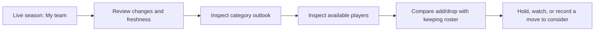

# Live-season decision support PRD

**Date:** October 20, 2026

**Status:** Flow approved October 21, 2026 with supporting detail in accessible help icons. First production slice: daily actuals and manual waiver contribution research. Full future standings/lineup forecasting remains a data and methodology gate.

**Product:** Personal, local, read-only ESPN league intelligence for the 2026–27 NBA season (ESPN season 2027).

**Current scope (approved October 25):** League landscape and category actions →
shared scenario → ranked waiver/roster research → independent alternatives against
one replacement. Per-game differences lead; optional seven-day totals require
explicit credited starts. Watchlist retains reasons and provenance; Data & settings
holds management controls. See [the approved workflow](season-workflow-design.md)
and [delivery](qa/2026-10-25-season-workflow-delivery.md). Earlier scopes below remain history.

**October 24 source approval:** Recent ESPN actuals in the selected 7/15/30-day
sample drive both lists and net comparisons, with projections explicitly separate.
Zero-GP/incomplete samples stay unranked. [Source contract](outlook-live-fit-design.md).

**October 23 flow and implementation approval:** Recent ESPN performance leads waiver
research, with 7/15/30-day windows and saved projections as a separate option.
The [new synthetic mock](live-season-waiver-preview.html) proposes category rank
colors → category-sorted targets → player trends/news → watch notes, keeping
manual comparison secondary. See the [bounded proposal](live-season-waiver-research-contract.md).
The user approved the revised mock and requested implementation. Recent-stat
ranking remains descriptive; future standings and legal-start forecasts remain gated.

**October 21 approval and implementation:** The user approves the mock, asks for
cleaner supporting help, and authorizes implementation plus league-context waiver
research. The [versioned contract](live-season-implementation-contract.md) bounds
the first calculation slice to actual standings and add-minus-drop contributions
under explicit manual seven-day starts. Future full-team percentages and league
points require additional verified inputs. See [delivery](qa/2026-10-21-live-season-delivery.md).
This supersedes the older pending-mock status below.

**October 20 mock delivery:** The user requested an interactive mock based on this
design. Review [Live season preview](live-season-preview.html): My outlook,
category-linked league/available-player research, seven-day add/drop comparison,
participation sensitivity and a page-local watchlist. All evidence is synthetic.
The mock is ready for feedback; its flow is not yet approved for production.
See [review checks](qa/2026-10-20-live-season-mock.md).

## 1. Product direction

Help me answer each day: **“Given my league's standings, my roster and the players actually available, where is my team heading, and which move deserves attention?”**

The draft is complete. The next product priority is managing the season using current league evidence. The existing auction and historical work remain useful supporting context. The central decision is whether a feasible change improves this team's category position over a stated horizon, after accounting for the player or lineup opportunity it replaces.

The first useful release connects three questions in one journey:

1. **What changed?** See the latest scored results, category positions, roster/status changes and collection gaps.
2. **Where am I heading?** Compare earned production plus a conditional remaining-season baseline across the current league.
3. **What should I investigate?** Compare keeping the roster with one add/drop over the next seven days, including category tradeoffs and current acquisition constraints.

A useful result may be **hold**, **watch**, or **insufficient evidence**. An available player with a high generic rank is not automatically an improvement to this roster.

## 2. Confirmed scope and assumptions

### User decisions — October 20, 2026

- Lead with season outlook plus a seven-day roster/waiver decision view.
- Collect automatically each day while the local app is open and connected; support manual refresh and visible collection gaps.
- Reuse dated Hashtag projections as a baseline and show recent actual performance separately. Remaining games and availability require explicit assumptions and verified inputs.
- Begin with transparent baseline/scenario calculations. Win probabilities are deferred.
- Deliver this codebase-backed PRD, data gaps, visualization requirements, phases and acceptance criteria. UI flow approval and implementation follow later.

### Context to verify before live advice

Existing product decisions describe a 12-team, eight-category roto redraft league: FG%, FT%, 3PM, PTS, REB, AST, STL and BLK; 10 active slots, three bench slots and two IR slots. Earlier research records a separate $100 in-season FAAB budget. These are setup expectations, not proof of current rules or remaining balances.

Verify the current ESPN season, participating teams, categories/directions/weights, tie treatment, roster slots, position eligibility, game or start limits, season end, lineup locks, acquisition effective times, waiver processing and acquisition limits. Verify FAAB only where used. Explicitly choose this season's **My team**; historical team or manager links cannot silently establish it.

The local read-only context check during this review returned a saved completed-2026 selection and no connected session. No current-season private refresh was performed. Current rosters, live rules and free agents therefore remain unverified. Keep identifiers and private league details out of public planning artifacts.

## 3. Codebase review and reuse

Reviewed the current working tree, including existing uncommitted auction work. This is a source and contract review, not certification that new live-season provider capabilities work.

| Area | Evidence in current source | Implication for this feature |
| --- | --- | --- |
| Entry/navigation | [Angular shell](../frontend/src/app/app.html), [shell state](../frontend/src/app/app.ts): Live season exists as a not-ready view; app opens in auction mode | Reuse this workspace. Propose the live entry/default in a synthetic mock before changing navigation. |
| Current league reads | [ESPN gateway](../src/fantasy_ai/infrastructure/espn_gateway.py), `map_league`; [league model](../src/fantasy_ai/domain/league.py) | Normalized snapshots preserve team/roster identities, scoring format and category count. They do not preserve daily scored stats, lineup slots, waiver state or complete live rules. |
| Refresh/session lifecycle | [Workspace service](../src/fantasy_ai/application/workspace.py), [memory session store](../src/fantasy_ai/infrastructure/session_store.py) | Reuse explicit connection, cancellation and failure handling. Scheduled live collection is new work; frontend operation polling is not daily collection. |
| Persistence | [DuckDB workspace repository](../src/fantasy_ai/infrastructure/duckdb_repository.py) | Reuse append-only observations, transactions, migration backups and the shared connection lock. Current roster snapshot tables alone cannot answer daily stat questions. |
| Archived stats/rules | [History mapper](../src/fantasy_ai/infrastructure/history_mapping.py), [archive models](../src/fantasy_ai/domain/history/models.py) | Reuse stat identifiers, ratio definitions and coverage concepts after checking live semantics. Archive player mapping deliberately selects whole-season actuals; it is not a daily game-log reader. |
| Roto scoring and category gaps | [Standings calculations](../src/fantasy_ai/domain/history/cohort_standings.py), [category geometry](../src/fantasy_ai/domain/history/category_geometry.py) | Reuse or extract pure rank/tie/gap calculations with live inputs and tests. Completed-season thresholds and integer gap ladders cannot become forecasts directly. |
| Projections | [Projection models](../src/fantasy_ai/domain/projections/models.py), [premium acquisition](../src/fantasy_ai/application/projections/premium.py), [draft aggregation](../src/fantasy_ai/domain/draft/projections.py) | Reuse immutable dated inputs, basis validation and makes/attempts. Existing aggregation explicitly represents full-roster production, not scored lineup forecasts. Full-season projected games cannot be reused as remaining games. |
| Player identity and context | [Reviewed links and news models](../src/fantasy_ai/domain/projections/player_information.py), [player information service](../src/fantasy_ai/application/projections/player_information.py) | Reuse reviewed Hashtag↔ESPN links and dated public context. News/status is evidence for investigation, not a numerical return-date or participation forecast. Waiver players may need links beyond the existing covered pool. |
| Historical transactions/dated rosters | [History gateway probes](../src/fantasy_ai/infrastructure/history_gateway.py), `_probe` | Transactions are a period-1 sample; dated roster semantics are explicitly unverified. Neither supports a complete transaction history or reconstructed daily lineups. |
| Live auction integration | [Auction service](../src/fantasy_ai/application/draft/live.py), [auction opportunities](../src/fantasy_ai/application/draft/opportunities.py) | Auction settlement, budget and availability concern the draft room. They do not establish in-season roster ownership, waivers, FAAB or current scored production. |
| Chart language | [Historical rank curves](../frontend/src/app/analytics/historical-rank-curves.ts), [UI style guide](ui-style-guide.md) | Reuse compact charts, native-unit inspection, accessible controls and shared styling. New live labels and interactions need mock approval. |

**Readiness conclusion:** The app has useful connection, persistence, identity, projection and category-analysis foundations. It lacks a verified daily scored-data pipeline, league-wide available-player feed, schedule/credited-game model and in-season scenario engine. Extending the auction dashboard would leave those gaps unresolved.

## 4. Daily decision journey



The proposed Live season landing view leads with My team, latest valid observation and the important changes since the last comparable check. Select a category to inspect league positions and the assumptions behind the outlook. That selection focuses the available-player comparison. Selecting a player opens an add/drop comparison with the user's chosen replacement and acquisition time.

Show results for both keeping the roster and the proposed change. Keep the seven-day and remaining-season horizons visible and distinct. A seven-day improvement cannot silently become a season-long recommendation. The user executes any transaction directly in ESPN; the app can save a watch or decision note locally.

Connection supports this journey globally. Historical evidence is optional supporting context. Do not require manager mappings or a complete draft ledger to use current team analysis.

## 5. Functional requirements

| ID | Requirement | Useful result |
| --- | --- | --- |
| LIVE-01 | Verify league/season, current My team and rule coverage; save the first verified post-draft/current-state anchor | The user knows which team and rules the analysis describes. A late first capture is labeled first observed state, not reconstructed draft completion. |
| LIVE-02 | Refresh daily while running and connected; provide manual refresh and explicit state for running, completed, failed, cancelled and sign-in needed | A failed refresh preserves prior evidence and shows when each dataset last succeeded. |
| LIVE-03 | Preserve scored team/category observations for every current league team, with games usage where verified | Current standings and a dated trend answer what changed without summing current players' full-season NBA stats. |
| LIVE-04 | Preserve dated player actuals and roster/lineup/status observations with explicit grain and coverage | Recent performance and role investigation use covered games; unknown days remain unknown. |
| LIVE-05 | Produce a keep-roster remaining-season baseline only when credited-game assumptions and input coverage support it | Show earned totals, future contribution and resulting league category positions separately. |
| LIVE-06 | Show category opportunity and exposure against all current league teams | Display current and projected gaps above/below, horizon and assumptions; distinguish a small gap from an attainable gain. |
| LIVE-07 | Retrieve the league's current available-player population, with pagination/completeness, ownership, waiver/FA status, eligibility and timestamps | Research eligible players actually in this league's pool, including candidates outside a generic top-200 list. |
| LIVE-08 | Compare one legal add/drop, or an addition to a verified empty slot, with keeping the roster over seven days | Include lost production, displaced starts, ratio effects, acquisition timing, roster legality and all eight category deltas. |
| LIVE-09 | Save a local watch or decision note with reason, category, horizon and evidence references | The user can revisit why a player mattered and whether the supporting situation changed. |

Trade evaluation, multi-move optimization, automatic lineup changes, transaction execution, calibrated probabilities, FAAB bid recommendations and push alerts are later scope. Candidate cost may show a verified remaining FAAB balance and a user-entered hypothetical bid; auction prices do not supply waiver value.

## 6. Visualization and interaction requirements

Every chart supports a decision, shares selection with its table/details, and has readable values without relying on color or hover alone. Use the established compact, light repository style. Keep timestamps, critical missing inputs and blocked advice visible; place longer formulas in disclosure panels.

| Visual | Question answered | Required interaction and safeguards |
| --- | --- | --- |
| Daily change strip and trend | What changed since my last valid check? | Toggle total roto points, category position and games usage; inspect exact dates. Break lines across collection gaps; mark revisions and unequal comparison intervals. |
| Eight-category outlook board | Where can I gain or lose ground? | Select category; distinguish current rank/points from conditional endpoint rank/points. Show production, next better/worse gap, games exposure and coverage. |
| League category plot | Which teams are within reach or threatening me? | Compare current values and conditional future endpoints in native units; highlight My team. Show all current teams, ties, source date and sensitivity assumptions. |
| Seven-day schedule/usage grid | How many usable starts could this move add? | Inspect player/date, scheduled game, eligibility, assumed active/bench/IR status, lock and cap constraints. Scheduled games and credited starts have different marks. |
| Available-player table | Which available player helps this team? | Filter by category, position and verified availability; sort transparently by conditional marginal effect against the selected replacement. Separate projection rates, recent actuals, games and news. |
| Add/drop comparison | Is the tradeoff worthwhile? | Compare keep/add/drop contribution and net category changes side by side, including losses. Recompute all league category positions under the same horizon and assumptions. |

No single opaque recommendation score is required. If a comparison cannot support total roto-point ordering, show the supported stat deltas and explain the missing comparison inputs.

Before frontend implementation, create a lightweight interactive HTML mock with synthetic data and the `fantasy-analytics-v1` marker using [showcase-theme.css](showcase-theme.css). Include entry/navigation, refresh, category selection, available-player inspection, a comparison result and relevant empty/error states. Obtain explicit flow approval before production UI or Markdown implementation stories.

## 7. Analytical definitions and boundaries

### Quantities and horizons

- **Actual:** provider-reported fantasy production credited to the team through a stated scoring cutoff. Current ownership does not determine who earned past points.
- **Recent performance:** NBA player actuals over explicit covered dates/games, including sample size, minutes and available makes/attempts. Distinguish NBA production from fantasy-credited team results.
- **Season outlook:** earned production plus modeled production from the same cutoff through the verified league season end.
- **Seven-day outlook:** earned production plus modeled contribution over the next seven league scoring dates, truncated at season end. Show the incremental window contribution separately.
- **Marginal move effect:** scenario result minus keep-roster result, using identical source versions, time cutoff, horizon and opponent policy.

For a counting category `c`, the conditional endpoint is:

```text
team_endpoint[c] = earned_team_total[c]
                 + sum(projected_player_rate[p,c] * expected_credited_games[p,horizon])
```

Expected credited games must respect the schedule, active slots, eligibility, lineup decisions, game/start caps and participation assumptions. Count each player's game at most once. Use one documented allocation policy for baseline and move scenarios, including displaced starts. Do not count every game from all 13 rostered players as a fantasy start.

For ratios, combine components, never average percentages:

```text
endpoint_FG% = (earned_FGM + future_FGM) / (earned_FGA + future_FGA)
endpoint_FT% = (earned_FTM + future_FTM) / (earned_FTA + future_FTA)
```

Missing numerator/denominator or zero attempts makes the affected ratio unavailable. Keep unknown values distinct from explicit zero; preserve earned counting totals even when a future estimate is blocked.

### First baseline and uncertainty

**October 22 research follow-up:** The user requests sample-size and fluctuation
support using the opening days' actual league evidence. The
[percentage-stability proposal](early-season-percentage-research.md) defines
the evidence gaps, per-player FT Bayesian candidate, FG shooting-mix concerns,
predictive versus ability uncertainty, evaluation gates and bounded delivery.
It is research direction, not approval of a production probability model or UI.

Use a compatible, dated Hashtag per-game rate baseline. Confirm whether the source represents preseason or remaining-season expectations; record source season, basis and update/capture date. Projected games from an old full-season snapshot are not remaining games, and provider projected games cannot be subtracted by team-credited starts to derive a valid player remainder.

Recent 7/14/30-day actuals are descriptive comparison windows, not automatic replacements for the baseline. A player without matching source coverage remains unprojected. Early-season small samples and injuries must be visible. Do not infer an injury return date from an “out” label or impute participation from an article.

Show explicitly chosen lower/base/higher participation or usage scenarios where supported. Label them sensitivity scenarios, not confidence intervals. Verify any combined rates/games assumptions to avoid applying the same injury reduction twice. If credited-game inputs are missing, show clearly labeled roster production potential or rate comparisons and withhold scored-outcome claims.

### League-relative value

Recompute category positions using **all current league teams**, their earned totals and their future production under the same documented baseline policy. A static-opponent current-gap diagnostic is useful if labeled; it does not establish a future point gain. Do not silently remove an opponent with missing data or use last year's returning-manager cohort as this year's league population.

Apply verified category direction, weighting, precision and ties before ranking; preserve unrounded calculation values. Conditional ranks of projected totals are not expected ranks or win probabilities. The add/drop comparison must recalculate every affected category, including the shooting denominators and categories that get worse. Report partial coverage without assigning a complete net roto gain.

Freeze opponents' assumed roster behavior for the first conditional baseline and state that assumption. Refresh actual ownership as it changes; do not claim to predict opponents' future transactions. Long-horizon add/drop extrapolation requires its own visible hold-duration assumption and cannot inherit a seven-day streaming result.

## 8. Evidence and collection contract

| Dataset | Minimum grain and metadata | Gate or fallback |
| --- | --- | --- |
| League rules and My team | League + season + rules revision; verified current team ID; effective/source and capture times | Unsupported or unverified constraints block legal/scored move claims. Do not reuse prior-season identity silently. |
| Scored team results | League + season + team + category + scoring cutoff; counts, ratio components, points/ranks and game usage where provided | Compare supported current categories; withhold incompatible derived ratios/ranks and show provider values separately where valid. |
| Player actuals | ESPN player + NBA game/date or verified daily period + stat context; final/provisional status | If daily grain is unavailable, label cumulative observation changes; do not call them yesterday's game stats. |
| Rosters and lineups | Team/player membership, eligible positions, active/bench/IR assignment, observed/effective time and coverage | Snapshot differences show observed changes, not exact transaction time or historical starts. |
| Available pool | League-wide ownership/waiver/FA status, returned population/filter, pagination and acquisition timestamps/rules | An incomplete or stale pool is a covered subset for research; no “best available” claim. |
| Future schedule | NBA team/game, start time, league scoring date, postponement/cancellation state, source/version | Unknown games or timing block precise seven-day starts; verify source capability in discovery. |
| Projections and participation | Provider identity/link revision, season, rate basis, horizon semantics, update/capture times and scenario assumptions | Preserve older versions; never silently convert a missing rate or unknown availability to zero. |
| Decisions | Local watch/scenario ID, evidence/version references, horizon, chosen replacement, acquisition assumption and note revision | Re-evaluate against new evidence; preserve the original reason/result and flag stale comparisons. |

### Daily operation

Proposed collection target: once each morning at **09:00 America/New_York**, shown as a configurable local setting. This time is an assistant proposal, not a confirmed league scoring boundary. UTC capture timestamps, league scoring dates and NBA game dates remain separate. Daylight-saving changes must not shift the intended local refresh time.

On opening/reconnecting after the target, offer or run one due refresh once access is verified. While running and connected, collect once when due; manual refresh remains available. Prevent overlapping work and deduplicate scheduled attempts without discarding a legitimately revised source observation. Use bounded retries/backoff for transient failures; expired access requires the existing explicit Connect ESPN flow. Disconnect/shutdown stops collection and clears the session.

Do not wake the machine or promise collection while closed/asleep. On resume, capture current state and record missed dates. Backfill only from independently verified dated provider evidence. A failed or cancelled run preserves the last complete valid state; mark partial dataset success individually. Publish a coherent comparison only when participating dataset cutoffs/versions satisfy a documented compatibility rule. A fresh roster must not disguise stale standings or an old available-player pool.

Treat the last completed scoring date as the intended daily comparison cutoff; expose source data that is still provisional. Keep intraday manual observations distinguishable. Source revisions, stat corrections and cross-refresh differences may be negative and must not be clamped to zero or interpreted automatically as a day's production. Derived views may choose a canonical daily observation while retaining all source revisions and failed-attempt metadata.

Freshness has two meanings: daily tracking coverage and whether availability/rules support a move **now**. Recheck relevant league state before final comparison, or show the comparison as stale/research-only. Decide dataset-specific freshness limits after discovery; a universal “updated today” badge is insufficient.

## 9. Architecture direction — proposed

Add a separate live-season domain/application slice with explicit read ports for scored league state, available players, player actuals, schedules, projections and observation storage. Keep ESPN mapping in adapters, pure calculations in Python, application orchestration through protocols and HTTP DTOs separate from provider responses. Wire adapters in the composition root.

Reuse the existing process-local session and the **same** workspace database connection lock. Keep collection, scenario calculation and source versions independent from the live-auction ledger and completed-season archive. Reuse pure scoring utilities through a small explicit boundary rather than forcing live state into `ArchiveTeam` or draft calculation assumptions. Exact module/schema/API design follows capability discovery.

Persist normalized, versioned, append-only live observations and transactionally committed observation groups. Separate attempted collection, dataset coverage, effective scoring cutoff and derivation versions. Preserve failed/incomplete attempts without replacing the last usable comparison. Migration design must back up and preserve existing history, draft observations and decisions.

Serve through local FastAPI and typed Angular services with explicit UI states. Keep the read-only local MCP adapter as a possible later sibling, once useful live contracts stabilize. Browser operation polling must not own the backend's daily schedule.

## 10. Delivery sequence and acceptance gates

These are proposed slices of the same daily decision journey, not authorization to implement before review. Start preserving reliable observations before introducing forecasts.

| Phase | Deliverable | Exit gate |
| --- | --- | --- |
| 0 — Verify evidence | Bounded connected discovery of current rules/team, scored totals/components, player daily context, available-pool completeness, acquisition timing and schedule source. Capture a first verified current anchor when implemented. | Document each capability as supported/partial/unavailable with a sanitized fixture and observed semantics. Resolve credited-game policy before forecast implementation. No new source is assumed to work. |
| 1 — Trust daily actuals | Scheduled/manual collection, current scored standings, date coverage, trend and roster/status changes; offline access | Reconcile supported standings with ESPN at the same cutoff; survive failed saves, reconnects, restart, stat corrections and missed days. No projection needed to retain daily data. |
| 2 — Explain the outlook | Same-cutoff, league-wide keep-roster baseline with category drilldown, games assumptions and sensitivity | Correct earned-plus-future arithmetic, ratios, ties, slots/caps and all-team coverage. Missing inputs block affected claims. |
| 3 — Support a move | Verified available players, seven-day usable starts, explicit add/drop comparison and local watch/reason | Show the marginal effect against keeping the roster, legal timing and all-category tradeoffs. Revalidate changed availability and evidence versions. |

**First complete decision-support release:** Phases 1–3 working together for one legal add/drop. Phase 1 alone is a useful tracking release, but does not fulfill the full outlook-and-move objective.

### Concrete acceptance examples — synthetic only

| Case | Required behavior |
| --- | --- |
| Earned production survives ownership change | A team has 1,000 credited assists. Dropping a player keeps those 1,000; only future eligible contribution changes. |
| Ratio aggregation | Earned FG is 100/200 and modeled future FG is 45/100. Endpoint is 145/300 = 48.33%, not the mean of 50% and 45%. Missing attempts withholds the ratio. |
| All-category tradeoff | At one shared endpoint, baseline AST is 1,500 versus a rival's 1,510. A legal move adds 12 net AST and crosses one untied position, but loses one BLK point. Display +1 AST point, −1 BLK point and net zero, assuming all other positions unchanged. |
| Scheduled games exceed usable starts | Two candidates each have four scheduled games, but one can fit only two legal active starts. Use two starts for that candidate; show the displaced/unused games. |
| Acquisition delay | A player clears waivers after Tuesday's lock. Exclude Tuesday's game from the move even if it appears in the seven-day schedule. |
| Partial league/projection coverage | One rival or affected player lacks required inputs. Keep supported observed stats visible and withhold a complete projected rank/net-point recommendation. |
| Missed day/correction | Collection misses two days, then cumulative STL changes by +5; a later correction is −1. Show an interval change and correction, not three invented daily game logs. |
| Availability changes | A watched player is rostered elsewhere before comparison. Mark the saved comparison stale and block a claim that the move is currently available. |
| Freshness mismatch/failure | A roster refresh succeeds but standings or persistence fails. Keep the previous coherent view, disclose dataset ages/failure and avoid an “up to date” success claim. |
| No season results yet | Before the first scored games, show the verified roster and conditional baseline. Do not present zero production as evidence of weakness or invent a trend. |

## 11. Success measures and verification

Product acceptance: in a walkthrough, the user can identify a category to protect or improve, explain the evidence and assumptions, and compare a feasible candidate with a named replacement without a terminal. The comparison can support holding the roster when losses offset gains.

Track collection coverage as successful intended daily cutoffs divided by eligible days since tracking began, displaying missed days separately. Track supported dataset/category/player coverage, whether a comparison is current, and time to the first useful category/move explanation. Do not count stale or partial observations as successful complete collection.

Engineering checks at implementation: pure synthetic fixtures for earned/future arithmetic, ratio components, ties/weights, eligibility, acquisition locks, caps and displaced starts; fake-adapter failure/cancellation/rate-limit cases; transaction/restart/correction and scheduler/DST cases; HTTP/UI blocked and recovery states. Use no real cookies or live ESPN in automated tests.

Semantic checks: distinguish current roster NBA production from team-earned fantasy production, use the full current league, preserve units/horizons, and demonstrate a move that improves one category while harming another. Passing transport or arithmetic tests alone does not establish sound advice.

Evaluate forecast errors chronologically once enough observations exist, separating rate, participation/lineup and source-revision errors. Retain the dated baseline available at each decision; never backtest with later projections. Calibrated probability or optimization work requires its own evidence and acceptance criteria.

## 12. Open decisions and next review

The product scope is confirmed. The following are discovery/design gates, not requests to reconfirm that scope:

1. Verify current My team and actual in-season rules, including game/start limits, daily locks, transaction effective times and FAAB where displayed.
2. Establish which scored components, historical daily/player stats, complete available-pool fields and future schedule fields the provider can supply reliably.
3. Choose and document a simple credited-game/lineup allocation policy plus remaining participation assumptions. Distinguish verified constraints from user overrides.
4. Confirm projection horizon semantics, current source coverage and an update workflow that does not assume unattended premium acquisition. The league's daily refresh need not refresh Hashtag automatically.
5. Review the proposed daily collection time, dataset compatibility/freshness rules and synthetic interactive flow before implementation stories and frontend changes.

**Current delivery status:** The October 20 planning/mock request was followed by explicit October 21 implementation approval. Daily actuals and manual contribution research are implemented under the linked contract. Verify current provider capabilities and the future lineup/participation policy before completing the remaining-season forecast objective.
